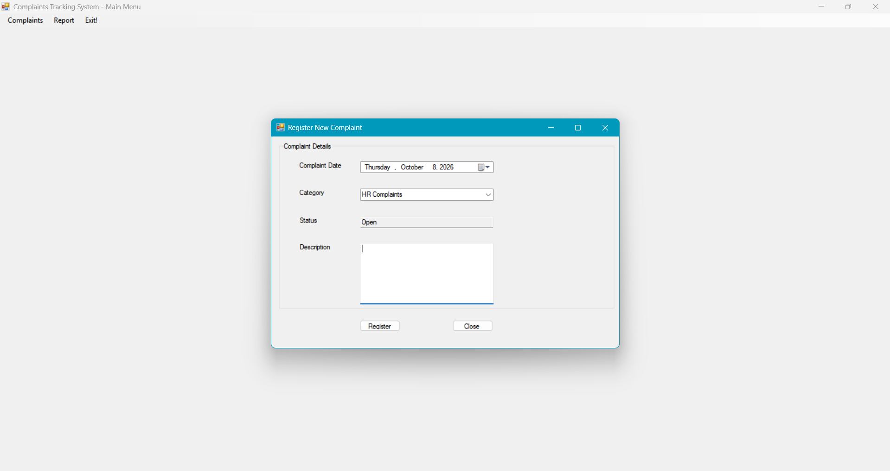
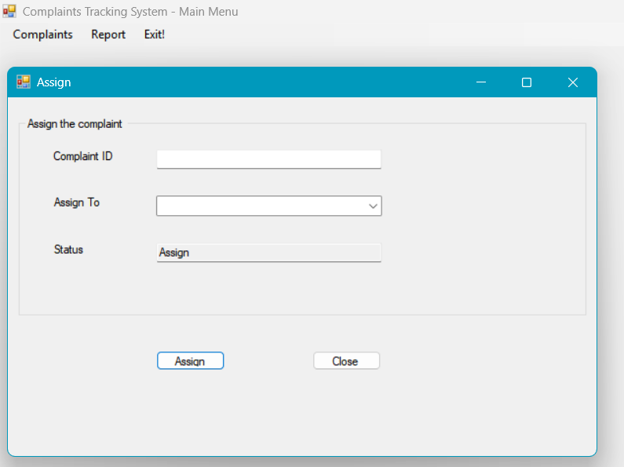
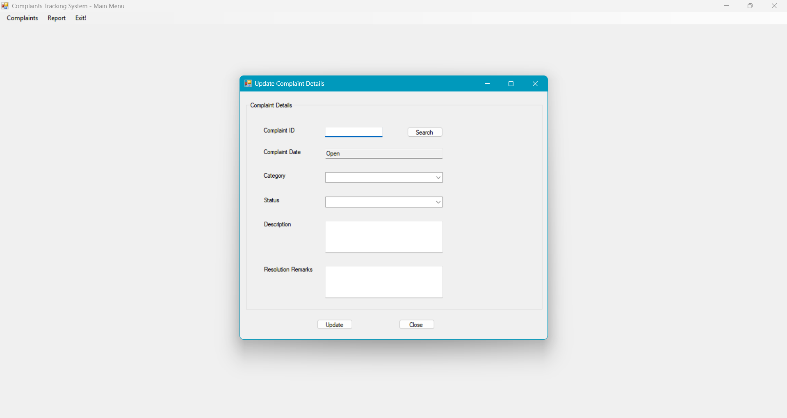
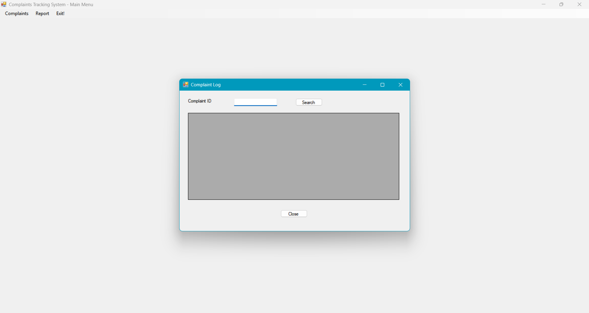

# 🎟️Complaints Tracking System 
A complete complaints tracking system built using SQL Server and VB.NET. It features a normalized relational database design to manage complaint registration, assignment, tracking, and reporting. The system is designed to support complaint intake, staff assignment, resolution updates, and reporting for efficient complaint handling.

## Features
- Database design with SQL Server for complaint data management
- VB.NET application for complaint registration, search, update, and reporting
- Workflow management for complaint assignment and resolution tracking
- Practical implementation of business logic in a database-driven application

## How It Works
- Complaint Registration: Users enter complaint details including category (e.g., Service Problem, Product Issue), description, and date. This stores the complaint in the database.
- Search and Filter: Users can search complaints by complaint ID or filter by category to quickly find relevant records.
- Assignment: Complaints are assigned to staff members who will handle the resolution.
- Update and Resolution: Assigned staff update the complaint status and add remarks about the resolution before closing the complaint.
- Reporting: The system generates reports summarizing complaints by category, status, and resolution time.

## Complaint Categories and Workflow
The system manages complaints through four main categories or stages:
- Register Complaint: Users lodge new complaints by entering details such as complaint category, description, and date. This initiates the complaint record in the system.

- Assign Complaint: Once registered, complaints are assigned to appropriate staff members for investigation and resolution. This ensures accountability and tracking.

- Update Complaint: Assigned staff update the complaint status, add remarks, and document progress or resolution details. This keeps the complaint record current.

- Complaint Log: The system maintains a comprehensive log of all complaints, including their registration, assignment, updates, and final resolution. Users can search and review complaint history here.

## Built With
- **SQL Server** – For designing and managing the relational database.
- **VB.NET** – For building the desktop application interface and business logic.
- **Visual Studio** – Development environment for VB.NET application.
- **.NET Framework** – Runtime framework for the VB.NET application.
